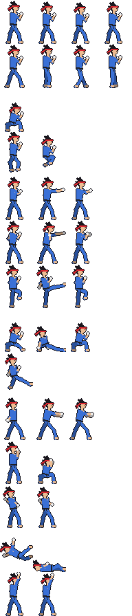

# Pixel Brawl

A small, original 2D fighting game prototype made with **Python + Pygame**.
You play 1 vs CPU against one of two fighters, best of 3 rounds.



## Run it

You need Python 3.9 or newer.

```bash
pip install -r requirements.txt
python main.py
```

Watch the CPU fight itself: `python main.py --demo`

## Controls

| Action | Keys |
|---|---|
| Move / jump / crouch | Arrow keys or WASD |
| Block | Hold **back** (away from opponent). Hold **down-back** to block sweeps |
| Light punch | J or Z |
| Heavy punch | K or X |
| Kick | L or C |
| Sweep (hits low, knocks down) | Down + Kick |
| Jump kick (must be blocked standing) | Kick while in the air |
| **Energy blast** | ↓ ↘ → + Punch (quarter circle forward) |
| Pause | Enter / P |
| Show hitboxes | F1 |
| Fullscreen | F11 |
| Back / quit | Esc |

**Combo tip:** a light or heavy punch that connects can be cancelled into the
blast: tap punch, then immediately roll ↓ ↘ → + punch.

On the character-select screen, use Up/Down to set the CPU difficulty (Easy / Normal / Hard).

## Fighters

- **Kai**: quick and balanced, fast blasts.
- **Rhea**: slower, but does 15% more damage.

## Editing the art in LibreSprite

All the art is plain PNG in `assets/`, so open these files in LibreSprite and
paint over them:

| File | Contents |
|---|---|
| `kai.png`, `rhea.png` | Fighter sprite sheets |
| `kai_blast.png`, `rhea_blast.png` | Projectile, 2 frames of 24×16 |
| `stage.png` | Background, 320×180 (scaled ×3 in game) |

Fighter sheets are a grid of **48×64 pixel frames**. Each row is one animation,
each column one frame. Draw characters **facing right**; the game flips them.
Keep the feet on the bottom row of each frame (y = 62) and the body centred
around x = 21.

| Row | Animation | Frames |
|---|---|---|
| 0 | idle | 4 |
| 1 | walk | 4 |
| 2 | crouch | 1 |
| 3 | jump (rising, tucked) | 2 |
| 4 | light punch (startup, hit, recovery) | 3 |
| 5 | heavy punch | 3 |
| 6 | kick | 3 |
| 7 | sweep | 3 |
| 8 | jump kick | 1 |
| 9 | energy blast | 3 |
| 10 | block (standing, crouching) | 2 |
| 11 | hit | 2 |
| 12 | knockdown (falling, lying) | 2 |
| 13 | win | 2 |

LibreSprite tip: set *View → Grid → Grid Settings* to 48×64 to see the frames.

`python tools/generate_sprites.py` regenerates the placeholder art. **This
overwrites your edits.**

## Project layout

```
main.py                 entry point
fightgame/
  game.py               app loop, title / select / fight scenes, HUD
  fighter.py            fighter state machine, physics, hit & hurt boxes, projectiles
  moves.py              frame data (startup / active / recovery, damage, stun)
  ai.py                 CPU opponent
  characters.py         fighter stats
  anims.py              sprite sheet layout
  sprites.py            asset loading
  spritegen.py          placeholder art generator
tools/generate_sprites.py
tests/smoke_test.py     headless CPU-vs-CPU test
```

To tune the game feel, start with `moves.py` (frame data) and `characters.py` (speeds and damage).

## Test

```bash
python tests/smoke_test.py
```
